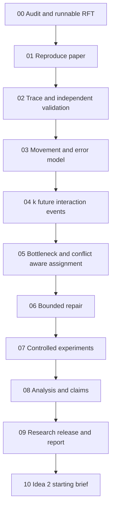

# Master execution plan for Idea 1

## Research objective

User update, 28 October 2026: [D001](../reports/decisions/D001_CURRENT_SOURCE_BASELINE.md)
adopts the latest verified public commits as the frozen starting baseline and
requires fresh measurements of every paper target. Exact manuscript provenance
remains a limitation rather than a Phase 00 blocker under this accepted scope.
Phase 01 is an automated current-source campaign. Independent Phase 02 schema/
validator preparation may proceed concurrently by user direction; final baseline
audits and dependent completion gates still apply. No proposed heuristic is
enabled before the validation/model prerequisites.

Determine whether the RFT compiler's fast compilation remains competitive after movement carries physically motivated time and error costs, and whether richer future-interaction information, routability-aware assignment, and bounded repair improve that tradeoff.

The scope is the proposal's Idea 1, supported by a reduced trace/validator/evaluator from Idea 5. The baseline retains individually addressed CZ operations and the RFT/DasAtom architecture. Global-pulse zoned compilation, general QDMI integration, fault tolerance, loss recovery, and Ideas 3–5 as standalone projects are outside the implementation scope. Borrowing a timing model or schema idea does not import the source paper's entire architecture.

## Questions and evidence

| ID | Research question | Main evidence |
| --- | --- | --- |
| RQ1 | How does realistic transport change the RFT–DasAtom quality/runtime tradeoff? | Frozen original schedules rescored under legacy and extended profiles; separately, schedules changed by actual cooling/timing constraints |
| RQ2 | Do the next k interaction events improve parking enough to justify their overhead? | k = 1, 2, 4, 8; strict legacy control; repeated-partner fixtures; family-specific runtime/error results |
| RQ3 | Does bottleneck/conflict-aware assignment outperform sum-distance assignment? | Same candidate sets and router; distance-sum versus bottleneck/composite variants; predicted versus actual routing cost |
| RQ4 | Does bounded repair improve the executable schedule at a predictable compile-time cost? | Repair off/on; accepted/rejected proposals; actual before/after error and time; budget sweep |
| RQ5 | Where do these conclusions change with hardware assumptions and problem scale? | Transfer/heating/coherence/grid sweeps; Pareto plots; failures and timeouts; complexity and memory accounting |

The proposal's expected positive outcomes are hypotheses. Negative or mixed findings are valid research outcomes. No fidelity recovery, speedup, optimality, or publication acceptance is promised.

## Sequence and gates

Each phase produces an accepted handoff. An owner reads that evidence before changing dependent code. Work can overlap only after shared interfaces are frozen: for example, drafting benchmark manifests during Phase 03 or drafting report methods during Phase 07. Do not run final evaluation while algorithms, physics, or preprocessing are still changing.

The minimal reproduction checks in Phase 01 use the original instruction format. The independent validator in Phase 02 then audits the frozen baseline before extension work. If it exposes a baseline defect, preserve the historical result, create an explicitly corrected control, and amend the reproduction report; do not retroactively relabel the original as validated.

## Define the baseline before extending it

Use three distinct identifiers throughout:

- `rft_paper`: revision/options supported by evidence as the paper implementation; unknown until Phase 00 resolves them.
- `rft_snapshot`: current public revision inspected in this planning session, `3d1f09233c2acd357fd9fbfad1b5300a921d301a`.
- `rft_corrected`: a separately versioned baseline containing only demonstrated correctness/reproducibility repairs, if needed.

The public code already includes ladder ablations, an optional future-biased assignment term, and an alternative eviction rule. Its RFT representation keeps next occurrences per partner rather than exactly one future partner per qubit. An extension's novelty must be assessed against both manuscript and current code, not against an assumed empty feature set. See [source review](../source_review/SOURCE_REVIEW.md).

## Proposed effort and planning horizon

These are owner-effort estimates, not promised calendar deadlines. Setup, author clarification, slow baselines, and compute availability can extend them. Re-estimate at each gate.

| Phase | Focused working days | Main uncertainty |
| --- | --- | --- |
| 00 | 3–5 | Historical revision, packages, and code/paper discrepancies |
| 01 | 5–8 | Full benchmark availability and DasAtom timeouts |
| 02 | 4–6 | Whether logs expose enough physical events |
| 03 | 6–10 | Compatible trajectory, cooling resource, and event semantics |
| 04 | 4–6 | k=1 compatibility and partner position estimates |
| 05 | 6–9 | Pair-level orientation, frozen conflict cost, feasibility |
| 06 | 4–6 | Correct local replay of downstream state and cooling |
| 07 | 6–10 plus compute | Number of feasible repeated baseline runs |
| 08 | 4–7 | Unexpected ranking reversals or invalid cases |
| 09 | 5–8 | Clean-environment reproduction and report integration |
| 10 | 2–3 | Candidate-generation support in DasAtom |

Idea 1 totals roughly 47–75 focused working days before the Idea 2 transition. Agent ownership can change between phases without changing these dependencies. Each owner first runs a small acceptance fixture rather than a long benchmark.

## Experiment design to preserve throughout

Reproduction: the paper's QFT 5–60, its exact Table II QTetris subset, and grids 11×11, 20×20, 35×35 where used. Extension evaluation: QFT through 100, QTetris, genuine seeded QAOA on three-regular graphs, and seeded quantum-volume circuits. Do not substitute a file containing one CZ per graph edge for a full QAOA circuit without labelling it as a graph-interaction microbenchmark.

Use original RFT and DasAtom as primary baselines. Evaluate Enola or Atomique when their capabilities and hardware can genuinely be matched; otherwise report a clearly separated architecture-specific study and the reason a direct comparison is invalid. ZAP is a timing/routing reference, not an automatic drop-in baseline on the individual-addressing RFT device.

Choose tuning/evaluation splits by circuit instance or family before sweeping heuristic weights. Hold the same synthesized CZ input, geometry, seed policy, resource limits, and validator/evaluator version constant across algorithm variants. Separate compilation time, offline layout generation, normalization, validation, and scoring. Include failures and timeout censoring in all aggregates.

## Completion definition for Idea 1

Idea 1 is complete only when Phases 00–09 have passed their stated gates, including:

1. A reproducibility ledger for every published target, with mismatches or unavailable artifacts explicitly recorded.
2. An explained and runnable baseline, immutable provenance, and a minimal independent correctness check.
3. A versioned common trace, independent validator, and source-backed hardware/error model with limitation labels.
4. Implemented and verified k-future table, assignment extension, and bounded repair, with independent disable controls.
5. Controlled evaluation and ablations for all four proposal steps, hardware sensitivity, runtime/memory scaling, and failures.
6. A report with claims tied to actual runs, supported complexity bounds, limitations, and reusable code/data instructions.
7. A clean-environment small reproduction and a manifest for the full experiment suite.

A decision to drop a substantive proposal contribution changes scope and must be documented as a scope change. A time limit does not automatically make missing work complete. Reproduction can be labelled partial; extension experiments based on an unresolved baseline must state that limitation and cannot satisfy an unqualified full-completion claim.

## Resources and risk handling

Start with CPU-only development; no GPU or quantum-device access is assumed. Phase 00 records CPU, RAM, OS, Python/package versions, numerical thread limits, and available disk. Phase 07 pilots time and memory before setting a capped study budget. Large sparse-grid offline layout generation and full baseline reruns may dominate compute.

If a dependency is unavailable, preserve the evidence, implement only necessary compatible adapters, and record the deviation. If a model requires hardware absent from RFT, use a separately labelled resource-enabled profile or a no-cooling profile. If the full method loses, diagnose per-term error and per-family behavior rather than tuning against held-out results. An explicit move to Idea 2 is a separate project decision, with the unfinished Idea 1 status preserved.
